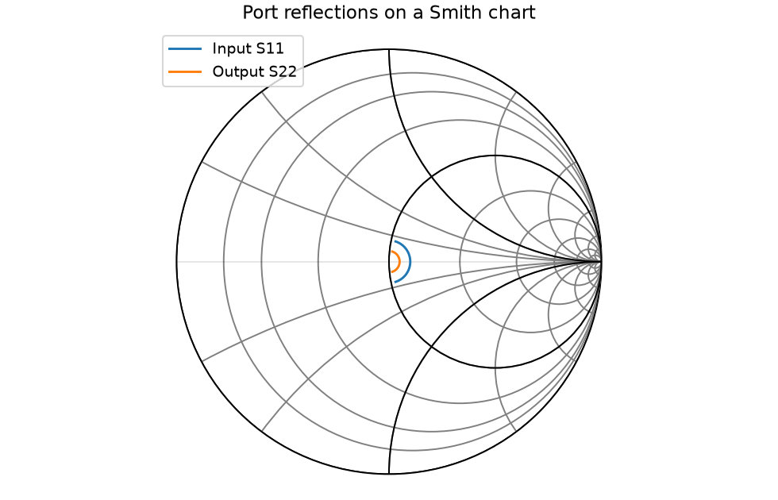

# RF measurement analysis

I built a Python tool for checking radio-frequency amplifier measurements because I needed a way to compare my calculations with answers I could work out in advance. It reads instrument exports, shows how much signal an amplifier passes or reflects, and estimates when it starts distorting a signal and how much noise it adds.

I can also automate instrument sweeps and check my signal processing with known tones, so I can test acquisition and analysis without a lab bench. I save the raw analyzer traces before doing any calculations.

I can run it with generated data first, then use the same commands with my own measurements. The included data is **synthetic**, not a claim that I measured a physical amplifier.

## Try it

With [uv](https://docs.astral.sh/uv/getting-started/installation/) installed:

```bash
git clone https://github.com/jackaI1/rf-measurement-analysis.git
cd rf-measurement-analysis
uv sync --locked --extra dev --python 3.11
uv run rf-analysis demo --output reports/first-run
uv run rf-sweep --frequencies 1000000 2000000 3000000 --powers -20 -10
uv run rf-dsp-demo
```

Open `reports/first-run/report/report.md` in a Markdown viewer. It contains a summary table and five plots. The folder also contains CSV tables for a spreadsheet and JSON results for another script. Use a new output folder for another demo run; the generator refuses to overwrite existing input files.

The sweep command captures six combinations and prints a new folder under `measurements/`. The signal-analysis command checks known tones and saves its CSV files in `measurements/dsp-demo/`. Both run without physical instruments, drivers or accounts.

[See the included example report](docs/example-report/report.md).

## What I check

| Measurement | What it tells me |
| --- | --- |
| S-parameters | How much of a small radio signal passes through or reflects back, including its phase, or position in the wave cycle. |
| Return loss | How little signal bounces back from a port. A larger positive number means less reflection. |
| VSWR | Another measure of reflection. A value of 1 means a perfect match; higher values mean more reflection. |
| Gain | How much the amplifier increases a small signal. A gain of 20 dB means 100 times the power with matched ports. |
| Smith chart | A map of the reflections that helps me see how well the input and output match their reference impedances. |
| P1dB | The input level where the output falls 1 dB below the small-signal prediction. This marks the beginning of significant gain compression. |
| IIP3 | An extrapolated measure of distortion from two nearby tones. Higher values mean less third-order distortion at the same input level. It is not a safe operating power. |
| Noise figure | How much the amplifier worsens the signal-to-noise ratio. Lower is better. I calculate it by comparing output noise with a hot and a cold source. |



## Use my own exports

A Touchstone `.s2p` file holds the four small-signal S-parameters versus frequency. I use scikit-rf to read its frequency units, complex values, port order and reference impedance, and to draw the Smith chart. The [scikit-rf Network documentation](https://scikit-rf.readthedocs.io/en/latest/api/generated/skrf.network.Network.html) describes the underlying format and plotting API.

The three CSV files need these headers. Extra columns are allowed.

| File | Required columns | Meaning |
| --- | --- | --- |
| Power sweep | `pin_dbm,pout_dbm` | Single-tone input and output powers at the amplifier connectors. |
| Two-tone sweep | `pin_dbm,fundamental_dbm,im3_dbm` | Input power **per tone**, one output fundamental, and one third-order distortion product. Use equal input tones. |
| Noise sweep | `frequency_hz,hot_dbm,cold_dbm,t_hot_k,t_cold_k` | Hot/cold output noise powers measured over the same bandwidth, and calibrated source temperatures in kelvin. |

Powers use dBm, a logarithmic scale referenced to 1 milliwatt. [The example inputs](examples/synthetic/) show complete files.

```bash
uv run rf-analysis report \
  --touchstone measurements/amplifier.s2p \
  --power measurements/power.csv \
  --two-tone measurements/two_tone.csv \
  --noise measurements/noise.csv \
  --p1-fit-points 5 \
  --ip3-max-input-dbm -30 \
  --output reports/my-amplifier
```

I choose the first `--p1-fit-points` low-power points where gain is flat. For IIP3, `--ip3-max-input-dbm` limits the fit to the linear region; omitting it fits every row. The tool checks the fitted slopes and residuals, and refuses a power sweep that never reaches 1 dB compression. `summary.json` records input paths, settings and fit diagnostics. Reports replace generated files in their destination, so I keep raw measurements in a separate folder.

I correct cable losses and reference input/output powers to the amplifier connectors before importing. Two-tone data must resolve the distortion above the instrument noise floor. The noise calculation assumes negligible receiver noise or measurements already corrected for it. It does not remove fixture losses or perform instrument calibration. Power and two-tone sweeps represent one operating frequency each; I keep their frequency and bias conditions consistent with the network and noise data myself.

## What I save

Every sweep gets a new UTC timestamped folder, even when I repeat the same settings. Each measurement has:

- A `.txt` file containing the analyzer's original text response, with only the communication terminator removed.
- A `.csv` file with frequency in hertz and power in dBm, a logarithmic unit relative to one milliwatt.
- A `.json` file with acquisition time, requested generator settings, settings read back from the generator, and the trace's strongest point.

The folder's `manifest.json` records instrument identities, sweep settings, timeout counts, completed measurements and whether the run finished or failed. If a later measurement fails, earlier files remain available. Output files are ignored by Git.

## How the sweep works

I use PyVISA, a Python interface for talking to lab instruments. The commands are SCPI, short text instructions such as `FREQ 1000000` and `POW -20`. The bundled pyvisa-sim definition provides a signal generator and spectrum analyzer that accept these commands and remember their settings.

For each combination, my script sets and checks the generator, enables its output, waits for any requested settling time, sets the analyzer's center frequency and span, triggers a capture, and waits for completion. It checks the returned trace length and numbers before saving. The generator output is switched off and both instrument sessions are closed when the run exits, including Python exceptions.

While waiting for the first response byte, a timeout gets two extra attempts by default. A timeout after any bytes have arrived stops the run so a partial response cannot be mistaken for a complete trace. I send the query once so a delayed response cannot leave duplicate replies waiting for the next command. Other connection errors stop the run immediately. I can change the timing with `--timeout-ms 1000 --retries 2 --settle-s 0.1`.

The simulator returns a fixed 21-point trace with a peak of -10 dBm at the center. Changing generator power does **not** change that trace: the two simulated instruments are not physically coupled. This checks command handling, readbacks, acquisition and file saving. It does not model RF gain, loss or instrument accuracy. Physical hardware has not been tested. [Instrument commands and hardware setup](docs/design.md) explain the backend options and what needs checking for a particular instrument.

## How I check the signal analysis

The analysis code works on evenly spaced voltage samples, not on the analyzer's dBm trace. An FFT, a calculation that separates a signal into its frequencies, gives a one-sided amplitude spectrum. I apply a Hann window to soften the record edges and correct its amplitude scaling. The power spectral density gives power per hertz; adding it across frequency recovers average signal power.

My low-pass FIR filter uses 129 weighted samples to retain low frequencies and reduce high frequencies. It delays the result by 64 samples. My signal-to-noise ratio estimate fits a sine wave at a known frequency and compares its power with the remaining variation, after removing a constant offset.

The seeded example contains a 256 Hz tone with 1.2 V peak amplitude, 0.1 V standard-deviation noise, and a 2048 Hz interfering tone. It checks its results and exits with an error if they fall outside the expected tolerances. A local run recovered 1.200000 V and 0.720000 V²; the known-tone ratio improved from 3.39 dB to 26.34 dB after filtering. `samples.csv`, `spectrum.csv` and `report.json` let me inspect the calculation. [Scaling, assumptions and limitations](docs/design.md#signal-processing) cover the details.

## How the amplifier calculations work

For a reflection coefficient Γ, return loss is `-20 log10(|Γ|)` and VSWR is `(1 + |Γ|)/(1 - |Γ|)`. Γ is S11 at the input or S22 at the output. Matched-port gain is `20 log10(|S21|)`. This is not a general calculation of gain for arbitrary source and load impedances. All four S-parameters are exported as real/imaginary values, magnitude in dB and phase in degrees.

For P1dB, I average `Pout - Pin` over the low-power baseline, then interpolate the first point where the measured gain has fallen 1 dB. For IIP3, I fit output fundamental and distortion power against input power separately and find where the lines meet. In the ideal case, their slopes are 1 and 3 dB per dB. OIP3 is the output value at that intersection.

For noise figure, `Y = 10^((Phot - Pcold)/10)`, `Te = (Thot - Y Tcold)/(Y - 1)`, and `NF = 10 log10(1 + Te/290)`. Te is the equivalent noise temperature added by the amplifier. The 290 K reference can be changed with `--noise-reference-k`.

[Measurement assumptions, model derivation and error handling](docs/measurement-methods.md) explain the details and the limits of these estimates.

## How I checked it

My synthetic amplifier uses a cubic voltage model, so the compression point and weak-signal intercept follow from the same coefficient. It has 20 dB small-signal gain, input P1dB of -5 dBm, IIP3 of about 4.636 dBm, and a separate thermal noise model with a 3 dB noise figure. The test suite checks the extracted compression points within 0.01 dB and both intercepts within 0.03 dB. It also checks hand-written data so a mistake shared by the generator and analyzer cannot be the only source of expected answers.

```bash
uv run pytest -q
uv run ruff check src tests
uv run ruff format --check src tests
```

The package separates measurement extraction (`analysis.py`), model data (`synthetic.py`), report writing (`report.py`) and the command line (`cli.py`). I added the instrument driver (`instruments.py` and `instruments.yaml`), sweep runner (`sweep.py`), numerical signal functions (`dsp.py`) and repeatable signal example (`demo.py`). GitHub Actions runs the tests on Python 3.11, 3.12 and 3.13, builds the package, and uploads a complete demo report. The combined suite has 89 tests and reached 91% statement coverage locally. It checks amplifier calculations, actual PyVISA simulation, timeout and failure paths, saved data, command-line use, and known signal amplitudes, noise and filtering. The workflow also runs both installed commands outside the checkout to check packaging, with a 90% minimum statement coverage gate.
