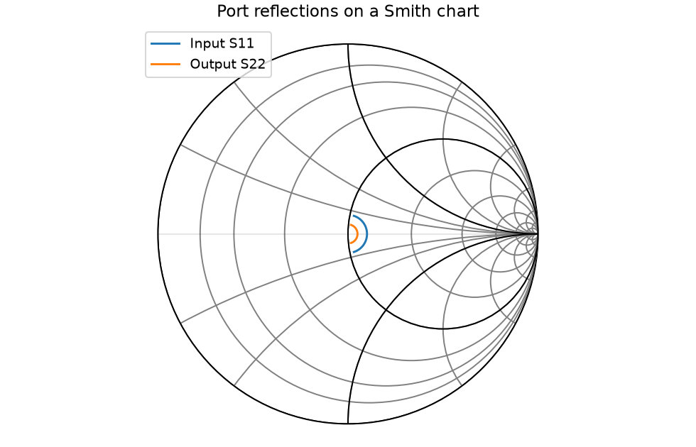
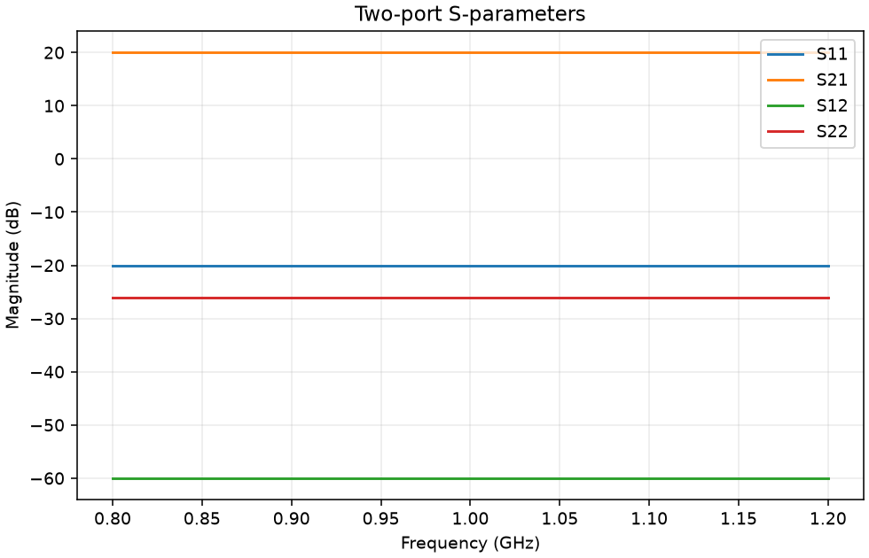
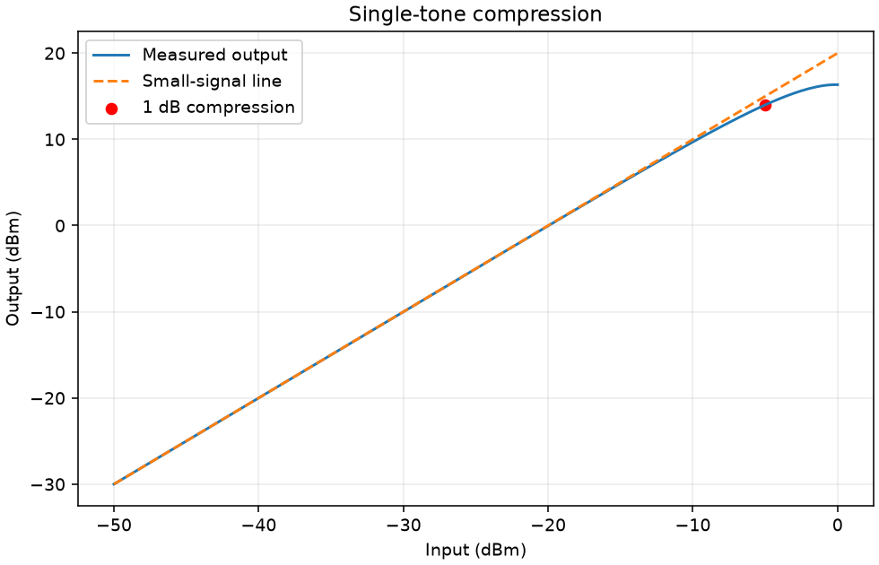
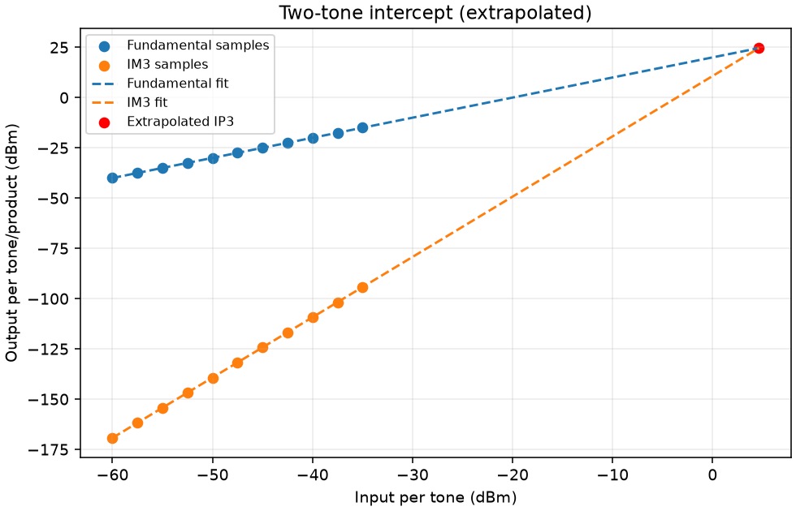
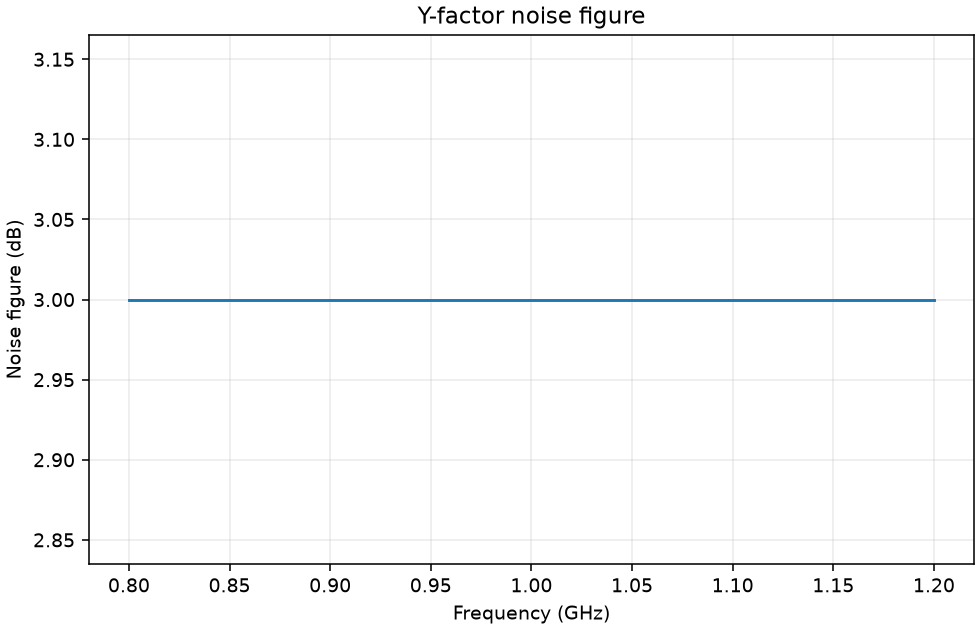

# RF measurement report

Synthetic cubic amplifier, not hardware measurements

Results use the connector-plane powers supplied in the input files.

| Metric | Value |
| --- | ---: |
| Small-signal gain (dB) | 20.0000 |
| Minimum input return loss (dB) | 20.0000 |
| Minimum output return loss (dB) | 26.0206 |
| Maximum input VSWR | 1.2222 |
| Maximum output VSWR | 1.1053 |
| Input P1dB (dBm) | -4.9999 |
| Output P1dB (dBm) | 14.0001 |
| IIP3 (dBm per tone) | 4.6332 |
| OIP3 (dBm per tone) | 24.6280 |
| Noise figure range (dB) | 3.0000 to 3.0000 |

## Assumptions

- Gain is |S21| in dB with matched reference ports.
- VSWR is undefined where reflection magnitude exceeds 1; its maximum is then null.
- Two-tone input is per tone; intercept is an extrapolation.
- Noise figure assumes calibrated source temperatures and negligible receiver noise.

See summary.json for input paths, fit settings, and fitted slopes.

